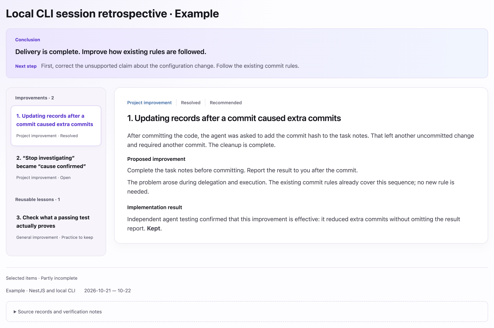

<p align="right">English | <a href="README.zh-CN.md">中文</a></p>

# TD Coding Retro

Review one **AI coding session**, identify problems worth addressing and practices worth keeping, and produce an **HTML report** to help improve your **Harness**.

## 1. Report preview

| Scope | Applies to |
| --- | --- |
| **General improvement** | Methods, rules or examples transferable to other applicable situations |
| **Project improvement** | This project's code, business behavior, rules or **Harness** |

[](./assets/report-preview-en.png)

## 2. Getting started

Install the local version from the repository root:

```bash
npx skills@latest add ./skills/engineering/td-coding-retro -y
```

**Review the current session**

```text
$td-coding-retro Review the current session.
```

**Review a specific session**

```text
$td-coding-retro Review session <Session ID>.
```

The agent reads the original session and checks relevant code, plans, check configurations and collaboration rules as needed. Missing records are reported as gaps, not treated as verified.

## 3. Implement only selected changes

By default, the skill proposes improvements without modifying the project or shared rules. After reading the report, you can say:

```text
Implement items 1, 3 and 5. Leave the others unchanged.
```

The agent uses the selected items to improve the project's **Harness**: collaboration rules, workflows, templates or automated checks. Reusable methods and examples go into the relevant shared collaboration resources.

An agent in a separate context then checks effectiveness to decide whether to keep or roll back each change. The method, observed effects and outcome are added to the original HTML report, with a brief notification in the terminal.
