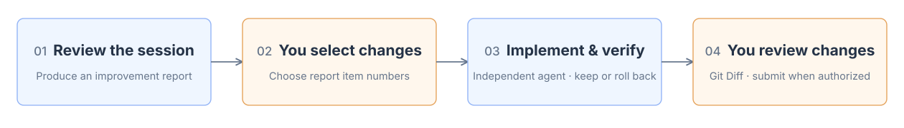

<p align="right">English | <a href="README.zh-CN.md">中文</a></p>

# TD Coding Retro

Review one **AI coding session**, identify problems worth addressing and practices worth keeping, and produce an **HTML report** to help improve your **Harness**.

## 1. Retrospective results



<details>
<summary>View a sample report</summary>


</details>

## 2. Getting started

**Install**

```bash
npx skills@latest add YangZhaoWeblog/skills-develop --skill td-coding-retro -g -y
```

**Review the current session**

```text
$td-coding-retro Review the current session.
```

**Review a specific session**

```text
$td-coding-retro Review session <Session ID>.
```

**After reading the report, select improvements to implement**

```text
Implement items 1, 3 and 5. Leave the others unchanged.
```

Improvements are classified as general or project-specific. After you select items, the agent identifies where to make the changes, then implements and verifies them.

After an agent in a separate context verifies the selected changes, results are added to the original HTML report. Retained changes stay in the working tree for your Git Diff review; commit and push require your explicit authorization.
