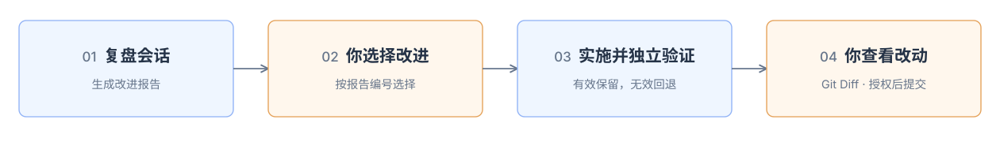

<p align="right">中文 | <a href="README.md">English</a></p>

# TD Coding Retro

复盘一次 **AI Coding 会话**，找出值得改进的问题和可以保留的做法，生成帮助改进 **Harness** 的 **HTML 报告**。

## 一、复盘效果



<details>
<summary>查看报告示例</summary>


</details>

## 二、开始使用

**安装**

```bash
npx skills@latest add YangZhaoWeblog/skills-develop --skill td-coding-retro -g -y
```

**复盘当前会话**

```text
$td-coding-retro 复盘当前会话。
```

**复盘指定会话**

```text
$td-coding-retro 复盘会话 <Session ID>。
```

**看完报告，选择要实施的改进**

```text
实施第 1、3、5 项，其他先不改。
```

改进分为通用改进和项目改进：可复用的方法与案例写入共享资料，项目专属的改动落实到当前项目。

选定事项经独立上下文 Agent 验证后，结果更新到原 HTML。保留的改动留在工作区，供你查看 Git Diff；commit、push 按你的明确授权执行。
