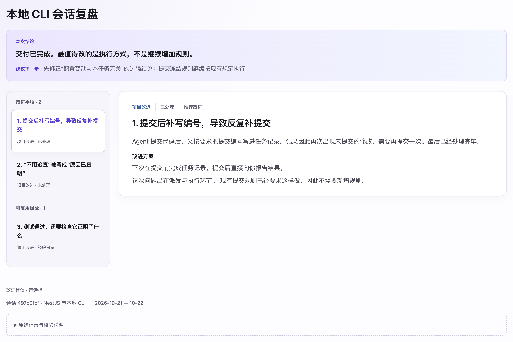

<p align="right">中文 | <a href="README.md">English</a></p>

# TD Coding Retro

复盘一次 **AI Coding 会话**，找出值得改进的问题和可以保留的做法，生成一份便于选择下一步的 **HTML 报告**。

## 一、开始使用

从本仓库根目录安装本地版本：

```bash
npx skills@latest add ./skills/engineering/td-coding-retro -y
```

**复盘当前会话**

```text
$td-coding-retro 复盘当前会话。
```

**复盘指定会话**

```text
$td-coding-retro 复盘会话 <Session ID>。
```

Agent 会读取原始会话，按需核对相关代码、Plan、检查配置和协作规则。无法取得的记录会明确说明，不把缺失部分当作已经核验。

## 二、看报告，选改进

[](assets/report-preview.png)

| 分类 | 适用范围 |
| --- | --- |
| **通用改进** | 可以迁移到其他适用场景的方法、规则或案例 |
| **项目改进** | 针对本项目的代码、业务、规则或 Harness |

## 三、选定后再实施

默认只提出建议，不自动修改项目或共享规则。看完报告后可以说：

```text
实施第 1、3、5 项，其他先不改。
```

Agent 根据选定事项，改进项目 Harness 中的协作规则、工作流、模板或检查机制；可复用的方法和案例写入相应的通用协作资料。
