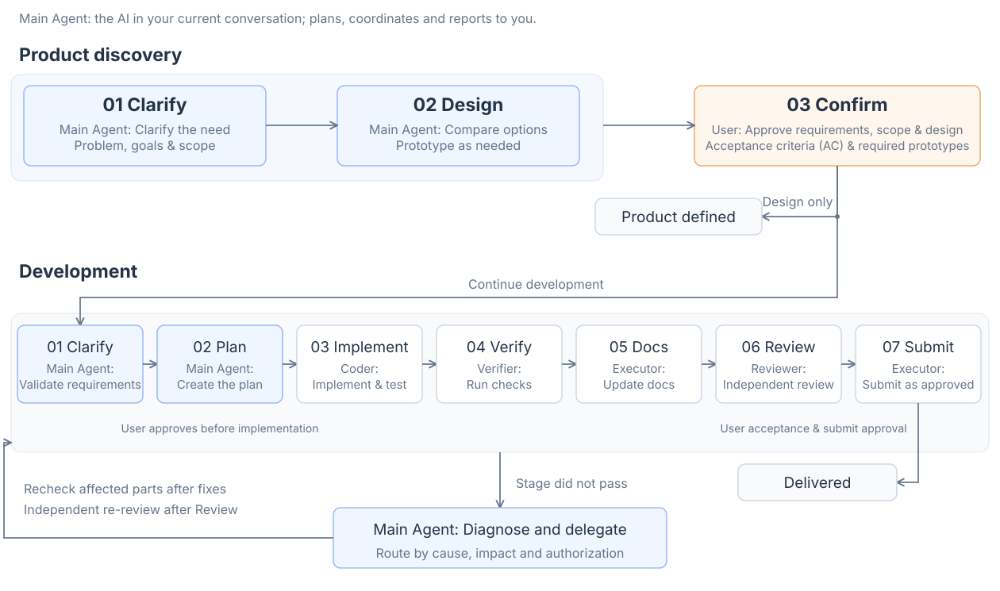
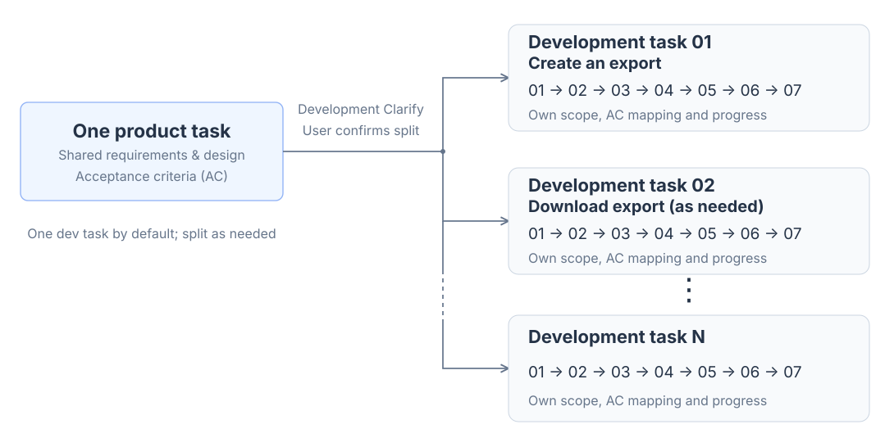

<p align="right">English | <a href="README.zh-CN.md">中文</a></p>

# TD Harness Build

Build or upgrade a project **Harness** with a **multi-agent workflow**, from requirements to implementation, verification and delivery.

## 1. Getting started

Install in the project directory:

```bash
npx skills@latest add YangZhaoWeblog/skills-develop --skill td-harness-build -y
```

Run in the project directory:

**New project**

```text
$td-harness-build I want to build an Obsidian plugin.
```

**Existing project**

```text
$td-harness-build
```

## 2. Workflow

[](assets/workflow-overview.en.svg)

[Detailed rework diagram](assets/workflow-feedback.en.svg)

### Product and development tasks

<p align="center">
  <a href="assets/task-relationships.en.svg"></a>
</p>
