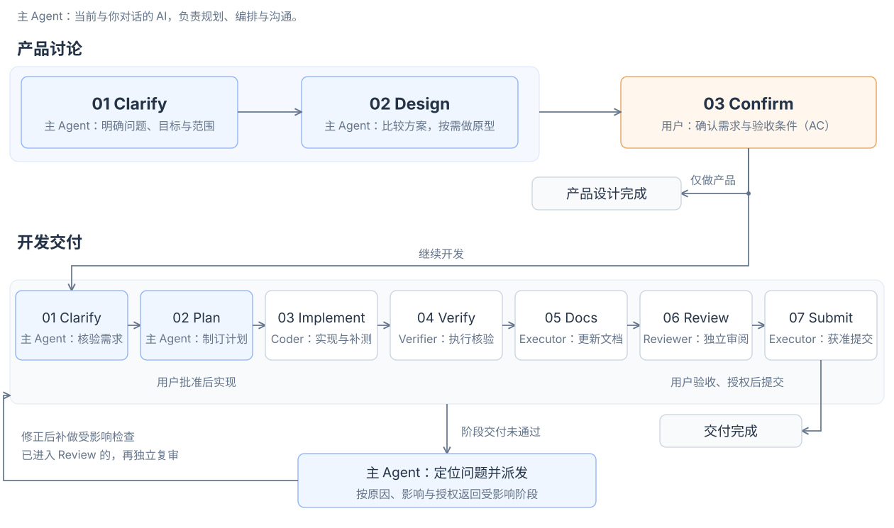
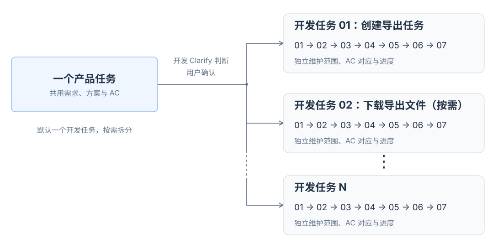

<p align="right">中文 | <a href="README.md">English</a></p>

# TD Harness Build

为项目构建或升级 **Harness**，提供从需求澄清到实现、验证与交付的 **多 Agent 协作工作流**。

## 一、开始使用

在项目目录安装：

```bash
npx skills@latest add YangZhaoWeblog/skills-develop --skill td-harness-build -y
```

**新项目**

```text
$td-harness-build 我想做一个 Obsidian 插件。
```

**已有项目**

```text
$td-harness-build
```

完成后检查差异，确认原有规则得到保留。

## 二、开始开发

直接说需求，AI 会按项目 **Workflow** 推进。

- **新增功能**：将选中的笔记导出为 Anki 卡片。
- **修复问题**：导出笔记时图片丢失了，帮我排查并修复。
- **改进体验**：导出设置太繁琐了，帮我重新设计一下。

## 三、工作流

[](assets/workflow-overview.svg)

<details>
<summary>查看详细返工图</summary>


</details>

### 产品任务与开发任务

<p align="center">
  <a href="assets/task-relationships.svg"></a>
</p>
