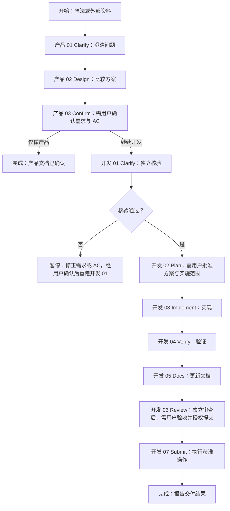

# {{PROJECT_NAME}} — AI 协作入口

**项目:** {{一句话项目用途}}；**Stack** 采用{{主要语言 / 框架}}

## 一、Index


| 何时读取               | 主题                   | 文件                                                                   |
| ------------------ | -------------------- | -------------------------------------------------------------------- |
| 派发工作或处理返工时 | **Agent 分工** | `.harness/agents.md` |
| 查看产品全景、用户流程和业务规则时  | **产品现状**             | `.harness/docs/product-state/product-map.md`                         |
| 讨论产品 或 核验开发条件 时    | **需求澄清**             | `.harness/docs/clarify.md`                                           |
| 修改模块或调用链时          | **架构与模块**            | `.harness/docs/architecture.md`                                      |
| 修改服务交互时            | **上下游依赖**            | `.harness/docs/dependencies.md`                                      |
| 核对接口和字段时           | **接口契约**             | `.harness/docs/contracts/index.md`，再读其中的实际契约源码                            |
| 设计或修改接口时           | **API 规范**           | `.harness/docs/contracts/api-standards.md`                                |
| 修改表结构或 Migration 时 | **数据库 / Schema**     | `.harness/docs/data/database.md`                                     |
| 设计用例或执行红绿循环时       | **Unit Test**        | `.harness/docs/testing/unit-tests.md`、`.harness/docs/testing/tdd.md` |
| 验证真实依赖协作时          | **Integration Test** | `.harness/docs/testing/integration-test.md`                 |
| 选择检查或处理失败时         | **验证规则**             | `.harness/docs/verification.md`                                      |
| 编写或修改代码时           | **编码与分层**            | `.harness/docs/coding-style.md`                                      |
| 新增日志或排查问题时         | **Logging**          | `.harness/docs/logging.md`                                           |
| 独立审查和人工验收时         | **Code Review**      | `.harness/docs/code-review.md`                                       |
| 准备环境、启动或调试时 | **本地开发** | `.harness/docs/runtime/local-dev.md` |
| 准备交付版本或执行发布、恢复时         | **发布与恢复**             | `.harness/docs/runtime/release.md`                                 |
| 核对项目专用概念时          | **术语表**              | `.harness/docs/glossary.md`                                          |
| 排查已知问题或完成复盘时       | **失败记录**             | `.harness/docs/failures.md`                                          |
| 讨论本轮需求或协调开发安排时     | **产品任务**             | 本轮 `product/00-overview.md`                                          |
| 恢复当前进度时            | **开发任务**             | 当前任务的 `00-overview.md`，再读当前阶段文件                                      |


## 二、Workflow

### 2.1 总体工作流程

总体分为 **产品任务阶段** 和 **开发任务阶段**，两者有对应关系且各自保持独立。

**重点：** 标有 **“需用户确认”** 的节点必须等待确认。**其他步骤 在已批准范围内连续执行；需确认的情况见“2.6 用户确认”**。




### 2.2 **产品工作流**


| #   | 步骤               | 产物                                                  | 说明                                                                                |
| --- | ---------------- | --------------------------------------------------- | --------------------------------------------------------------------------------- |
| 01  | **Clarify（澄清）**  | `01-requirements.md` §1                             | 明确用户、问题、目标和范围；外部资料按原意转为本轮需求与验收条件（Acceptance Criteria，AC），来源记入 Overview，缺口或冲突交用户确认 |
| 02  | **Design（方案设计）** | `01-requirements.md` §2                             | 比较方案，按需用图片或交互原型消除疑问                                                               |
| 03  | **Confirm（确认）**  | `01-requirements.md` §4、`02-acceptance-criteria.md` | 用户确认需求、范围、方案、AC 及必要原型；开发以本轮确认文档为依据                                                |


产品讨论可以跨会话。已确认的技术选型写入 **.harness/docs/architecture.md §6「技术选型与设计决策」**，注明尚未落地的部分；产品 Overview 只保留链接。恢复时读取本轮产品文档及选型依据，不要求用户重述。工程或必要检查尚未接入时，先按 **td-harness-build** 续做并验证，再进入开发 Clarify；产品确认不等于 Harness 初始化完成。

### 2.3 **开发工作流**


| #   | 步骤                | 产物                | 说明                                                                                    |
| --- | ----------------- | ----------------- | ------------------------------------------------------------------------------------- |
| 01  | **Clarify（澄清）**   | `01-clarify.md`   | 核验需求与 AC 是否明确、可实现、可验证；确认任务范围和必要拆分                                                     |
| 02  | **Plan（计划）**      | `02-plan.md`      | 逐文件列改动、影响和契约；设计验收测试（Acceptance Test，AT）及其他检查，写明通过标准与回退；用户批准后实现                        |
| 03  | **Implement（实现）** | `03-implement.md` | 按计划逐行为红绿循环，持续执行低成本检查                                                                  |
| 04  | **Verify（检查）**    | `04-verify.md`    | 执行所选检查及 AT，记录失败和复验；必要项通过或例外获准后继续；检查选择、测试复用、环境准备与失败处理见 `.harness/docs/verification.md` |
| 05  | **Docs（文档更新）**    | `05-docs.md`      | 更新受影响的长期事实和契约历史；无变化说明不涉及                                                              |
| 06  | **Review（独立验收）**  | `06-review.md`    | 独立核对需求、规则和证据；修正复验、复盘后，用户验收最终版本并明确提交授权                                                 |
| 07  | **Submit（提交）**    | `07-submit.md`    | 按授权执行 commit、push 或 PR；合并和发布另行授权。提交策略、预登记与冻结见本阶段文件，报告实际结果                             |


**Agent 分工**：主 Session 负责 Clarify、Plan 与编排；独立 Coder 实现，Verifier 验证，Reviewer 审查；Executor 更新文档并执行获准提交。派发、批量返工及权限见 **[agents.md](.harness/agents.md)**。

每阶段按对应文件填写，核对其**完成检查**，更新 Overview 的进度与实际时间后再继续。批准范围内连续执行也保留这些记录；缺项先补齐，漏记时间如实注明。

### 2.4 目录与职责

一个需求共用一份产品资料，按需拆成多个开发任务：

```text
.harness/plans/YYYY-MM-DD_数据导出/  # 完整需求：用户创建导出任务，并下载生成的文件
├── product/
│   ├── 00-overview.md             # 来源与确认；任务拆分、AC 归属、依赖及任务链接
│   ├── 01-requirements.md         # 需求与方案
│   ├── 02-acceptance-criteria.md  # 验收依据与场景入口
│   └── acceptance.feature        # Gherkin 验收场景
└── development/
    ├── task-01_创建导出任务/
    │   ├── 00-overview.md         # 当前步骤、进度与决策
    │   └── 01…07 阶段文件         # 各阶段执行结果
    └── task-02_下载导出文件/       # 同样结构，独立记录进度
```

### 2.5 创建与恢复

**恢复任务**

| 任务 | 定位依据 |
|---|---|
| 产品任务 | 用户指定的产品 Overview |
| 开发任务 | 当前分支与 Overview 的 Meta 匹配 |

**查找时只读 Meta**，排除模板目录；定位不明确时请用户确认。

若任务未结束，读取其 Overview、当前阶段文件及 Index 中的相关规则，汇报进度并继续；
Submit 已预登记完成时，先核对 Git／平台实际结果；仍有获准操作未完成的，继续原 Submit，不按已结束任务新建。
新需求按下方步骤创建；同一需求继续更新产品文档，原开发任务已结束时，后续开发另建任务。纯答疑不创建任务。
当有特定需要查看其他的产品需求/开发任务时，只允许读必要 Overview，不读正文，读到的内容也仅供参考，不直接写回当前任务。

**创建任务**

1. **建目录与分支**：确定任务目录；开发任务从项目集成分支建立工作分支，一分支对应一任务，保留无关改动和历史任务。
2. **完整复制**：按下方命令复制整套模板；目标已存在时恢复任务，不覆盖。
3. **清理模板说明**：填写后删除顶部创建说明；将 `WORKFLOW-GUIDANCE` 标记的整段规则块（含标记）替换为对应原模板文件的引用，保留表格和任务记录。

在项目根目录执行，替换本次目标路径；产品任务将模板目录改为 **.harness/templates/product/**。

```bash
template_dir='.harness/templates/development'
task_dir='.harness/plans/YYYY-MM-DD_<title>/development/<task>'
mkdir -p "$(dirname "$task_dir")"
test ! -e "$task_dir" && test ! -L "$task_dir" && cp -R "$template_dir" "$task_dir"
```

在副本中填写，**保留章节、表格与完成检查**；不适用项写明原因，后续阶段保持未开始。开发任务一次复制 **00–07** 全部文件，技术正文放外部时仍在 **05-docs.md** 记录目标、改动与一致性核对。

### 2.6 用户确认

一般情况，可在已批准的范围内连续执行，不再重复询问。出现下表情况时，说明问题和建议，等待用户决定后继续。

| 需要用户确认的情况 | 提交给用户的信息 |
|---|---|
| 存在需要用户选择的方案 | 选项、主要取舍及推荐理由 |
| 缺少影响后续工作的关键决定 | 缺什么、影响什么、需要用户决定什么 |
| 需求或 AC 必须修改 | 问题依据与本轮文档修改方案；经用户确认并重新核验后继续，更新外部原文另需授权 |
| 修正超出批准范围，包括历史模块、架构或数据结构 | 具体变更与影响；旧代码重构按 verification.md 核对方案授权 |
| 涉及未授权环境、真实数据或外部副作用 | 操作内容、影响及所需授权 |
| 必要验证无法完成，或独立核验有实质争议 | 缺口、依据及处理方案；工具缺失与跳过规则见 verification.md |
| 需要降低门槛或接受风险例外 | 例外原因与风险 |


---

## 三、开发准则

### Commands（项目命令）

**Module / Package**：{{模块或包名}}；**入口**：{{启动入口；库项目填写公开入口}}


| 用途        | 已有入口              |
| --------- | ----------------- |
| 构建 / 类型检查 | {{命令或规范章节链接}}     |
| 测试 / 质量检查 | {{测试、编码规范中的固定入口}} |
| 代码生成      | {{命令或不涉及}}        |
| 本地启动      | {{命令或不涉及}}        |


在开发工作流中，按任务范围执行这些入口。Git hooks 和 CI 的接入情况以实际配置为准；工具缺失明确标记。详细命令与参数在对应规范维护，本表作为索引。

### Structure（目录与分层）


| 路径         | 职责与边界                 |
| ---------- | --------------------- |
| {{入口目录}}   | {{启动与依赖装配}}           |
| {{核心模块目录}} | {{业务、数据访问等实际分层及依赖方向}} |
| {{生成目录}}   | {{生成源及允许的修改方式}}       |


只列开发时必须知道的目录。完整关系见 `.harness/docs/architecture.md`。

### Rules（项目硬约束）

从项目现有规范和实际代码填写高频约束；详细规则维护在对应专题文档。


| 约束      | 规则与依据                    |
| ------- | ------------------------ |
| 分层与依赖   | {{允许的调用方向、复用代码归属及依据}}    |
| 接口与数据变更 | {{契约先行、生成代码、迁移和兼容要求及依据}} |
| 编码与错误处理 | {{项目特有约定及规范入口}}          |
| 保护分支    | {{实际保护分支；禁止直接推送}}        |


开始实现前核对：工作分支有效、改动聚焦、Plan 与适用测试用例齐备、分层符合约定；记录一句话目标和硬阻塞，无则写“无硬阻塞”。

---

## 四、禁止红线


| #   | 红线                                                                     |
| --- | ---------------------------------------------------------------------- |
| 1   | **严禁擅自读取或引用其他任务正文。** 仅按“2.5 创建与恢复”定位和调度；用户明确指定的参考内容只留对话上下文，禁止自动写回。     |
| 2   | **严禁未授权实现。** 未获用户对当前 Plan 与实施范围的明确批准，不得写生产代码或启动写代码 Agent。              |
| 3   | **行为改动严禁先实现后补测试。** Plan 先列用例，Implement 按行为逐个 Red → Green；具体边界见 TDD 规范。 |
| 4   | **严禁编造执行证据和时间。** 未执行、失败、漏记必须如实记录。                                      |
| 5   | **严禁直推保护分支、使用裸 `--force` 或夹带无关改动。** 提交与合入按 Submit 授权及项目规则执行。           |
| 6 | **禁止将外部输入直接拼接进 SQL。** 使用参数化查询（Parameterized Queries）。 |
| 7 | **禁止硬编码凭据（Hardcoded Credentials）。** 包括密钥、Token 和密码。 |
| 8 | **必须校验外部输入（Input Validation）。** 输出按场景转义（Contextual Output Escaping）。 |
| 9 | **加密必须使用标准库（Standard Library）。** |
